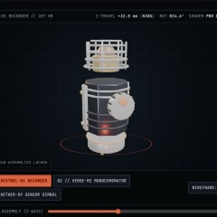
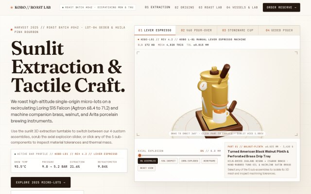

# droid-demos

A collection of demos and builds created with Droid, the AI software engineering agent from Factory, using the Factory app.

| Project | Directory | Live link | Model, tokens, time |
| --- | --- | --- | --- |
|  | [`chibi-jelly-painting`](chibi-jelly-painting) | [chibi-jelly-painting.vercel.app](https://chibi-jelly-painting.vercel.app) | Opus 5.5 + Sonnet 5.5 (high) ~580K tokens 1h 25m active |
|  | [`lindqvist-cmm-04`](lindqvist-cmm-04) | [lindqvist-cmm-04.vercel.app](https://lindqvist-cmm-04.vercel.app) | Gemini 4 Argon (high) · `/awwwards` + `/jury` + Blender 4.2 ~8.24M uncached tokens (37.86M w/ cache) 4h 53m active · 8.00/10 jury |
|  | [`kobo-roast-lab`](kobo-roast-lab) | [kobo-roast-lab.vercel.app](https://kobo-roast-lab.vercel.app) | Gemini 4 Argon (high) · `/awwwards` + `/jury` + Blender 4.2 ~6.63M uncached tokens (34.93M w/ cache) 3h 54m active · 8.61/10 jury |
