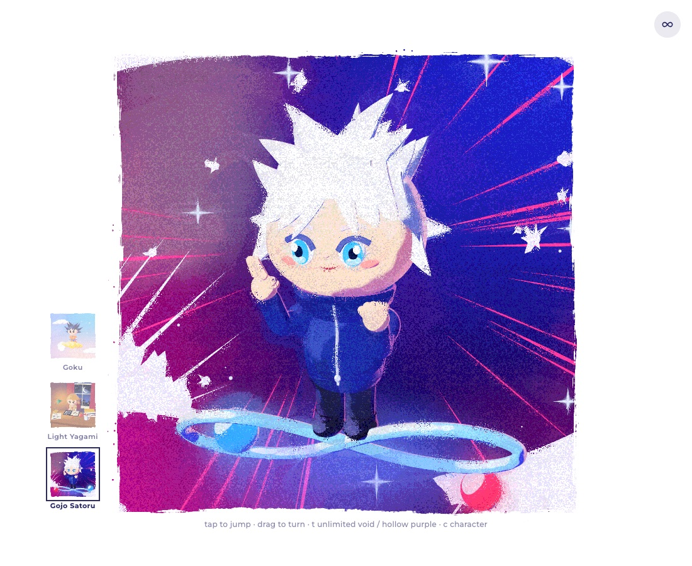
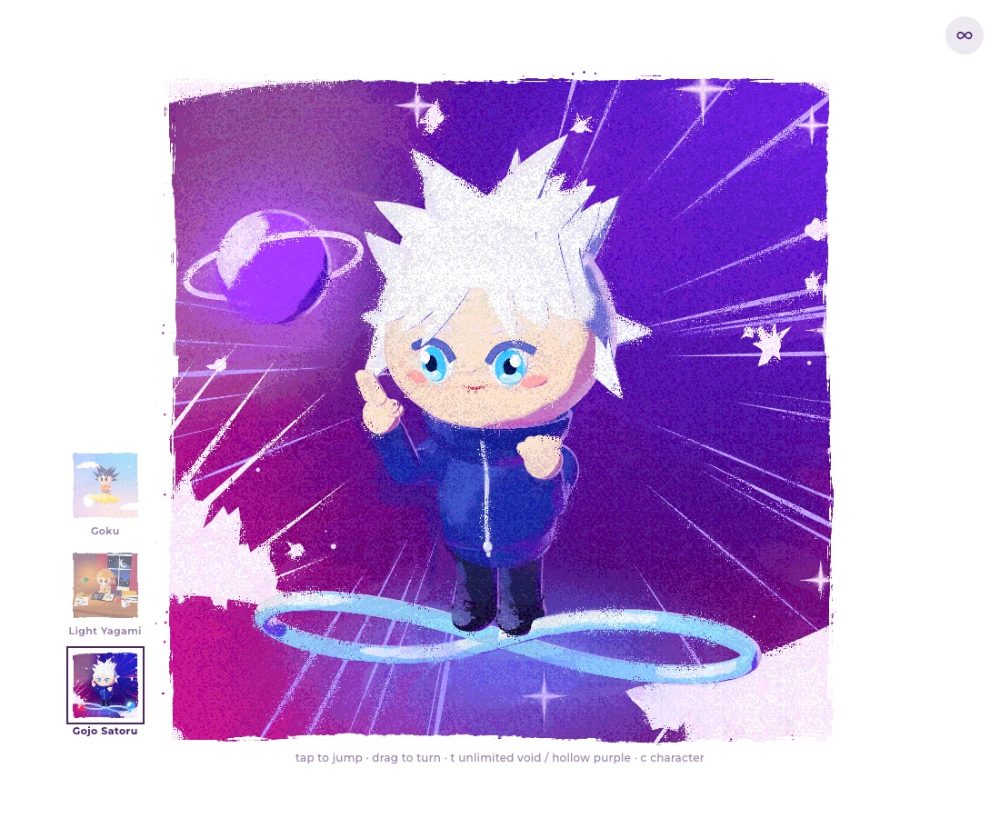
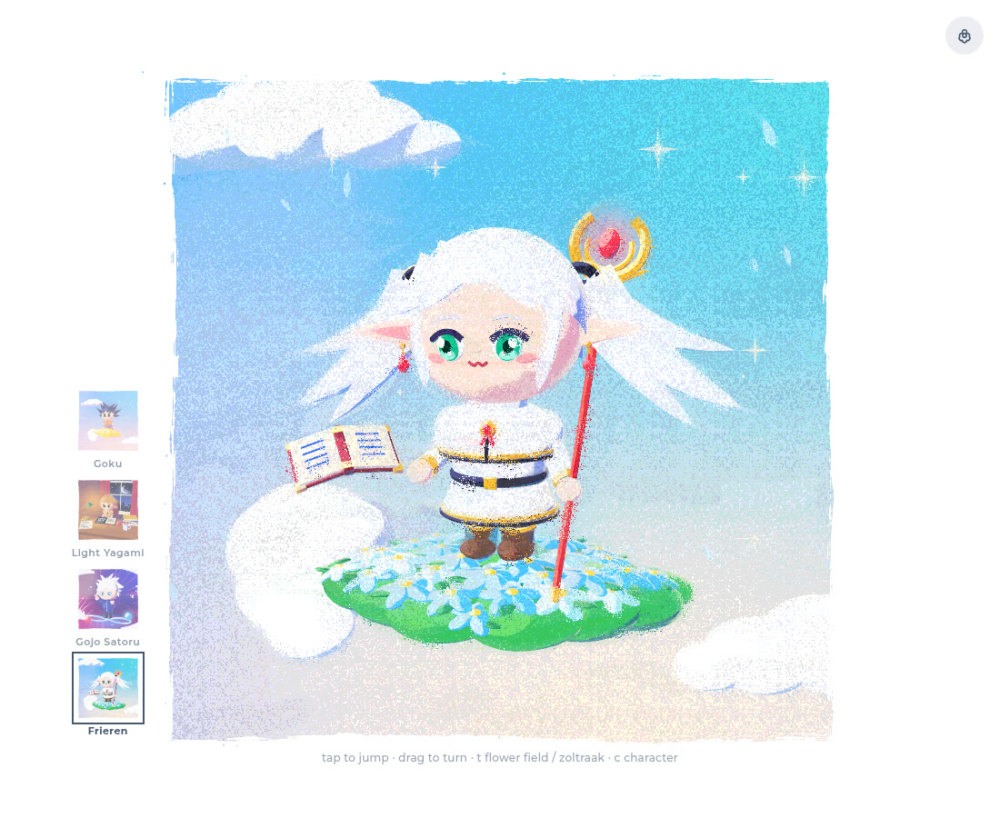
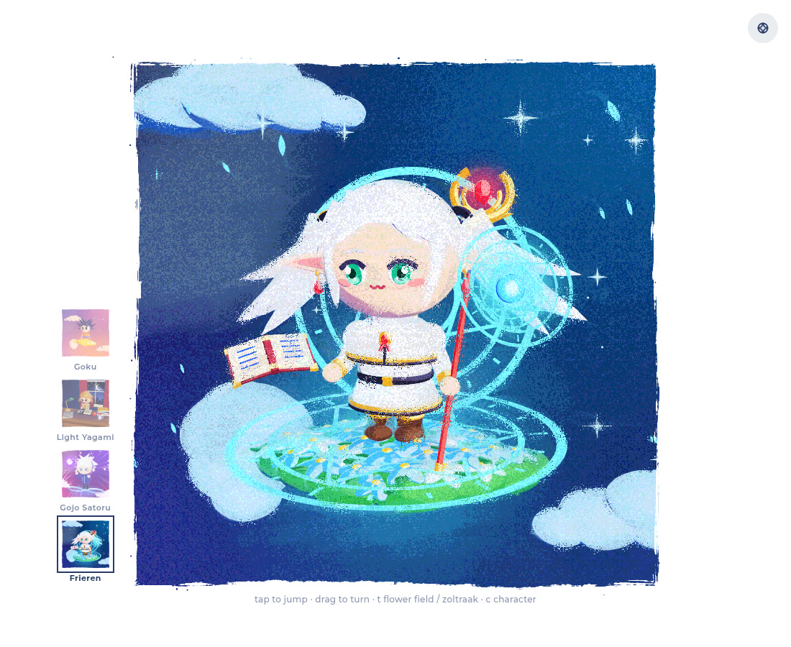
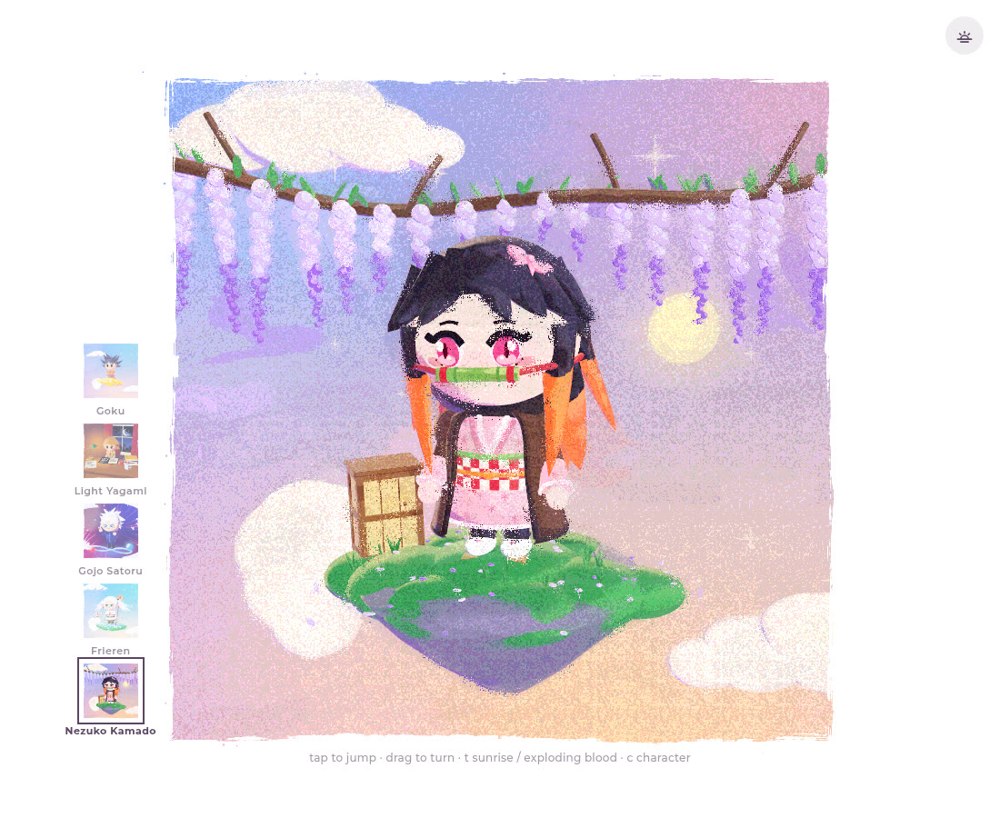
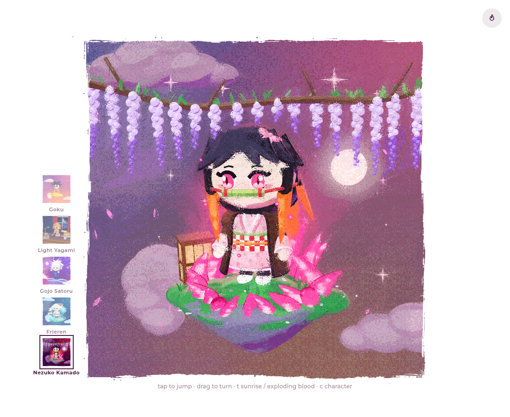
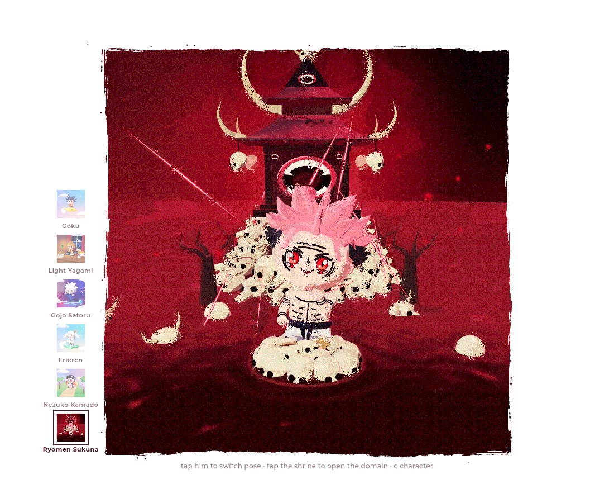
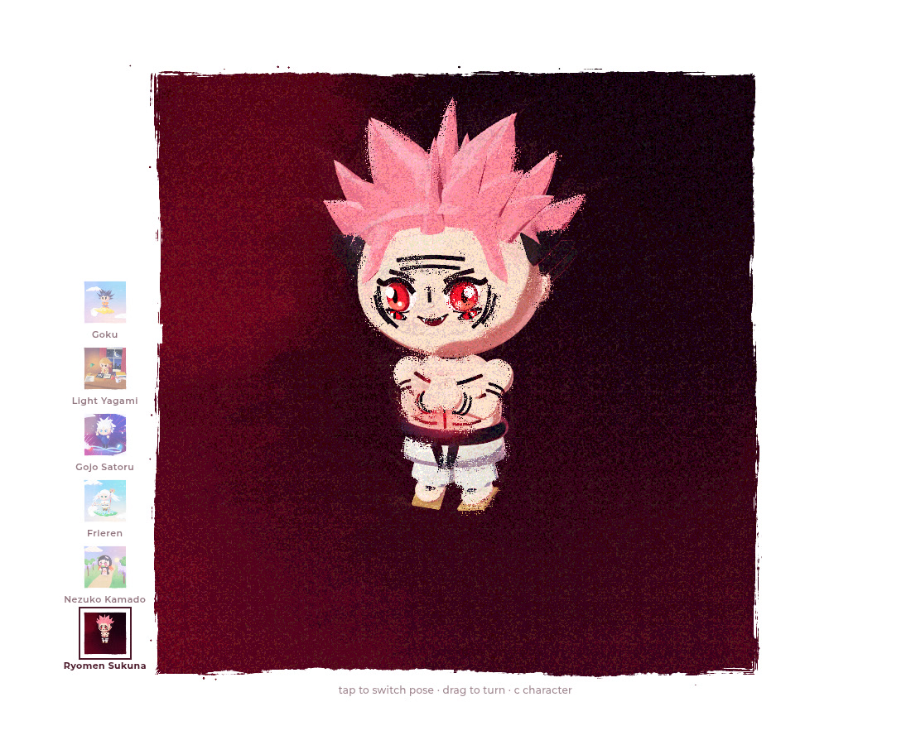
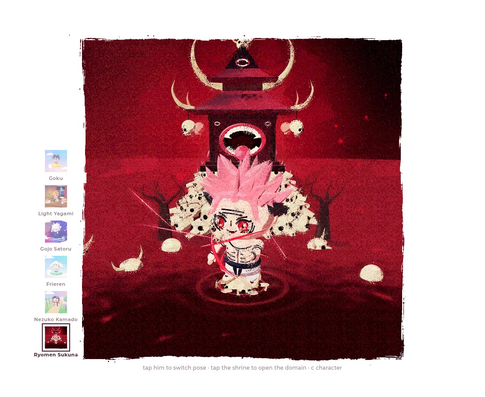

# Chibi Jelly Painting

A chibi martial-arts kid riding a wobbly cloud, a smirking chibi Light Yagami
sitting at his desk at night, writing in the Death Note, a chibi Gojo Satoru
hovering over an Infinity sign in a void of ink, a chibi Frieren standing in a
floating bed of Blue-Moon Weed flowers with her mage's staff and open grimoire, a
chibi Nezuko Kamado running down a path between wisteria trees, and a shirtless
chibi Ryomen Sukuna cycling through three poses (King of Curses lounge, Malevolent
Shrine hand sign, and Cleave & Dismantle slash dash), painted
live in the browser. One page, one switch for the mood (day and dusk in the sky, lamp
light and moonlight at the desk, Unlimited Void and Hollow Purple in the void, Flower
field and Zoltraak in the meadow, Sunrise and Exploding Blood under the wisteria; Sukuna
locks his crimson-and-charcoal King of Curses palette with no mood switch), one
card per character.

<p>
  
  
  
</p>
<p>
  
  
</p>
<p>
  
  
</p>
<p>
  
  
</p>
<p>
  
  
</p>
<p>
  
  
  
</p>

- **Live:** [chibi-jelly-painting.vercel.app](https://chibi-jelly-painting.vercel.app)
- **Model:** Opus 5.5 (high) for the build, Sonnet 5.5 (high) for the final polish, video, repo and deploy
- **Tokens:** ~580K (300K input + 279K output), plus 35.7M read from cache
- **Time:** 1h 25m of active agent time, spread over several days of iteration
- **Built with:** Droid in the Factory app
- **Stack:** three.js WebGPU + TSL (WebGL 2 fallback), Vite
- **Style:** a screen-space paint filter after mesq's [Jelly Painting](https://x.com/mesqme/status/2106646827193778352)
- **Character:** built from primitives in code, with no model files

## Run it

```bash
npm install
npm run dev      # http://localhost:5173  (add ?webgl to force the WebGL 2 backend)
npm run build    # static build in dist/
```

## Controls

Tap the character to jump (Light only hops in his chair; Sukuna leaps into his next pose), tap the cloud, Light's notebook, Gojo's Infinity sign or Frieren's flower bed to bounce it (Nezuko just keeps running, and Sukuna needs no stage), drag to orbit, scroll to zoom.
Six painted cards beside the sheet pick the character, **Goku**, **Light Yagami**,
**Gojo Satoru**, **Frieren**, **Nezuko Kamado** or **Ryomen Sukuna** (each hops in on arrival); the selected one is outlined. An icon-only
button in the top right flips the mood: sun / moon for Goku's sky (day, dusk), lamp / moon
for Light's desk (lamp light, moonlight), the Infinity sign / a purple orb for Gojo's
void (Unlimited Void, Hollow Purple), a Blue-Moon Weed blossom / Zoltraak magic seal for
Frieren's meadow (Flower field, Zoltraak), and a rising sun / pink flame for Nezuko's wisteria
(Sunrise, Exploding Blood); on Sukuna the mood button hides. The card previews are
captured from the live pipeline at load. Add `?char=light`, `?char=gojo`, `?char=frieren`, `?char=nezuko` or `?char=sukuna` to open on a
specific character.
Keys: `space`/`j` jump · `w` wave · `t` mood · `c` next character · `1` Goku · `2` Light Yagami · `3` Gojo Satoru · `4` Frieren · `5` Nezuko Kamado · `6` Ryomen Sukuna · `g` paint settings.

## How it works

- `src/materials/painted.js` — painted lighting. Object-space brush noise bends the
  shading normal (a procedural stand-in for hand-painted normal maps), then hard,
  noise-wobbled light bands break surfaces into flat painted planes with cool
  shadows, a rim light, a warm bounce from the cloud and a pastel haze that
  keeps the darks soft.
- `src/post/paintFilter.js` — the screen-space painting, all TSL:
  1. paper + torn frame (static): a square sheet with a torn, deckled edge,
     dry-brush bristles and loose paint flecks on the paper around it
  2. stroke grid (static): jittered dabs, each with a random ticket
  3. structure tensor of the colors (Sobel), blurred twice (detail + wide halo)
  4. flow: a stroke direction running along color edges, double-angle encoded
  5. strokes: march 10 steps each way along the flow, smear the color and let the
     strongest dab on the path claim the pixel with its flat center color
  6. composite: agreement-gated smear, speckle (cells that borrow color from a
     few pixels across the stroke, heaviest on edges) and a screen-locked
     9-level dither that gives the multi-hue pastel grain. Impasto relief,
     paper grain and edge pooling are available in the settings but off by default
- `src/scene/character.js` — the kid, built from primitives (no model files). It also
  exports the head, hair-blade and torso helpers the other character reuses.
- `src/scene/yagami.js` — Light Yagami, same recipe: honey-brown bowl cut with a swept
  fringe, narrow eyes with a red glint, a smirk, the tan jacket and red tie, and a pen
  in his right hand. He sits behind his desk instead of riding a cloud: the open Death
  Note on the desk plays the cloud's part (block lettering on the inside cover, names
  on the page, a bookmark ribbon that sways, a bounce when tapped), plus Ryuk's apple.
  Reference: the Death Note wiki and the Light Nendoroid.
- `src/scene/room.js` — his desk at night: the wooden desk (its top is as high as his
  waist, so it hides his legs) and the back of his chair, a brass desk lamp whose glow
  is a real uniform (`light.lamp`) that fades the halo, the pool of light on the desk
  and the bulb, a window onto a lit city with a crescent moon and Kira-red curtains,
  stacked books, a sheet of names and a mug of pencils. The wall is the painted
  backdrop; the far clouds and sparkles are hidden here.
- `src/scene/gojo.js` — Gojo Satoru: messy snow-white hair (tufts on the crown, bangs
  that hang between his eyes), pale blue Six Eyes with a lighter rim and a soft lash
  line, a dark navy jacket zipped up to a high collar that flares around his chin, and
  longer sleeves so one hand can make the two-finger sign (palm out) beside his cheek while the
  other grips his collar. In place of the cloud he hovers over an Infinity sign (a
  lemniscate tube) that his Blue and Red orbs run around. In the Hollow Purple mood
  the two orbs spiral together into a churning purple orb of energy that throws
  sparks over his raised hand. Reference: the JJK wiki and the Gojo Nendoroid.
- `src/scene/void.js` — his backdrop: white ink waves with flung drops and thin speed
  lines, flat shapes that always face the camera so orbiting never shows them edge-on.
  Their colours (and the `purple` mix that drives the orbs) are theme uniforms.
- `src/scene/frieren.js` — Frieren: silver-white hair in long sweeping twin-tails tied with
  black-and-gold ribbons, long pointed elf ears with red drop earrings, calm emerald-green
  eyes with a relaxed lash line and cat-like smile, a white gold-trimmed capelet with a red
  brooch over her belted tunic and skirt, dark tights and cuffed brown boots, holding her
  red crescent mage's staff. She stands in a floating bed of Blue-Moon Weed blossoms with an
  open floating grimoire and drifting petals; in the Zoltraak mood, glowing geometric spell
  circles unfurl behind her, around the meadow and at her staff tip.
- `src/scene/nezuko.js` — Nezuko Kamado, modelled on her Nendoroid: a slightly oversized
  head, a short choppy fringe parted at the centre so her forehead shows, and a full, wavy
  fall of black hair that turns flame-orange toward the tips (each lock is an orange blade
  under a slightly larger black one that ripples along the same curve, so the orange licks
  up its edges). She has a pale pink ribbon, big round glossy pink eyes with a rose ring and
  two catch-lights, thin high brows, a chunky bamboo muzzle wrapped in red cloth, a pale
  pink asanoha kimono with a red-and-white checkered obi, orange obijime and green obiage,
  a long black haori hanging open, striped black kyahan, white tabi and pink-strapped
  zori. Her legs are jointed at hip and knee and
  she runs in place (`run` in the rig) while a dirt path streams back under her: petals,
  pebbles, grass and wisteria trees ride past and wrap around, and a tree that would come
  between the camera and her bows out of the way. In the Exploding Blood mood pink flames
  burn around her feet and embers trail off behind her. Reference: the Demon Slayer wiki
  and the Nezuko Nendoroid.
- `src/scene/sukuna.js` — Ryomen Sukuna in his shirtless Domain look: swept-back spiky
  salmon-pink hair over a dark charcoal undercut with two loose front strands, four glowing
  crimson eyes (his secondary cursed slit pair sits beneath the main eyes and blinks with
  them), a fanged arrogant smirk, black cursed tattoo markings across his forehead, nose,
  cheeks, bare chest, shoulders, back and wrists, clawed hands and pleated white hakama
  trousers with a dark obi sash and zori sandals. He has no environment props and no mood
  toggle; instead he runs a 3-pose state machine (`POSES`) that smoothly interpolates every
  joint (and jumps to the next pose when tapped): slouched mid-air King of Curses lounge
  with his chin propped on his right hand, standing Malevolent Shrine (*Fukuma Mizushi*)
  Enmaten hand sign with a crimson cursed aura, and a forward Cleave & Dismantle slash lunge
  surrounded by razor-tapered crimson, white and black-ink crescent blade arcs.
- `src/scene/glow.js` — the soft round glow shared by the lamp, the moon and the orbs.
- `src/scene/world.js` — the nimbus cloud (recolorable), far clouds, the painted
  multi-hue sky and the twinkling sparkles.
- `src/scene/rig.js` — springs for bobbing, blinking, head tracking, squash-and-stretch
  jumps, hair lag, tail swish and the occasional wave. A character can hold an arm
  pose by exposing `armRest` (with `scribble` for a hand that is writing), pick which
  arm waves (`waveSide`, with its own `wavePose` if the default would hide the hand
  behind the head), bob and hop less (`bobScale`, `jumpScale`), run in place
  (`run`, swinging its `legs` if it has them), tick its own `update(t)`, and may
  have no tail. A prop can be `grounded`: it stays on its desk (`baseY`) and only squashes,
  and may have an `update(t)` of its own (Gojo's orbs).
- `src/main.js` — also gives each character their own camera height (`view.polar`),
  so Light is seen from above enough to read the notebook; the camera eases there on
  a swap until you grab it.
- `src/themes.js` — two moods per world, eased every frame: `sky` (day, dusk), `room`
  (lamp light, moonlight), `void` (Unlimited Void, Hollow Purple), `meadow` (Flower
  field, Zoltraak), `wisteria` (Sunrise, Exploding Blood) and `sukuna` (a locked
  crimson-and-charcoal King of Curses palette). The switch picks a slot; each character's world decides
  what it looks like.

Dev-only debug hook: `window.__chibi` (renderer, scene, camera, controls, filter, cast, theme, character).
