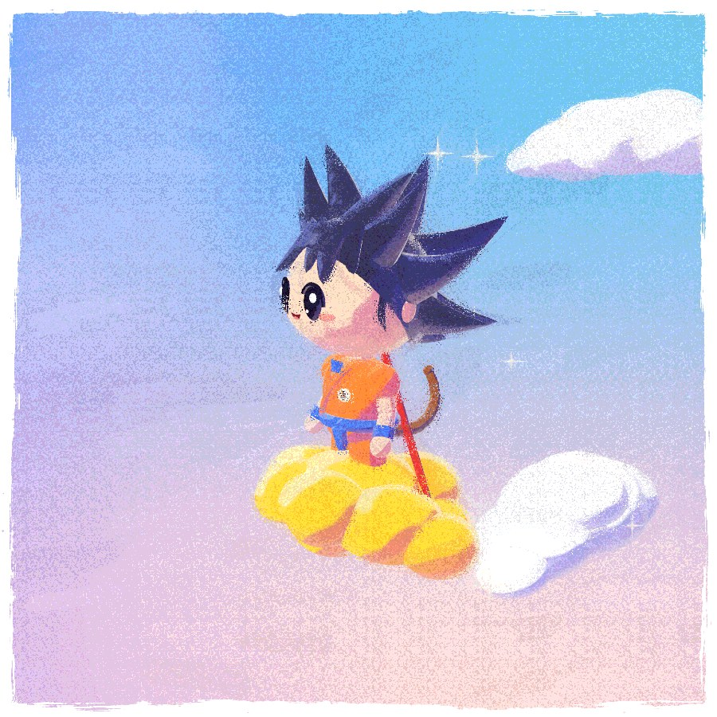
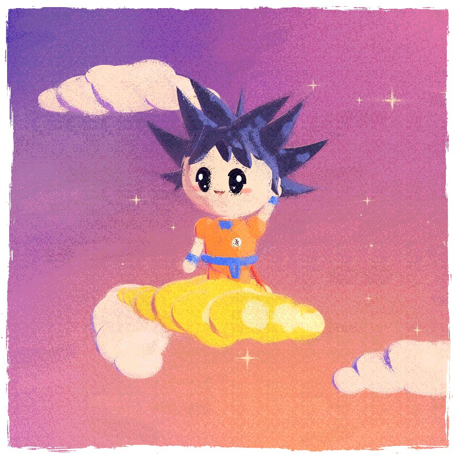
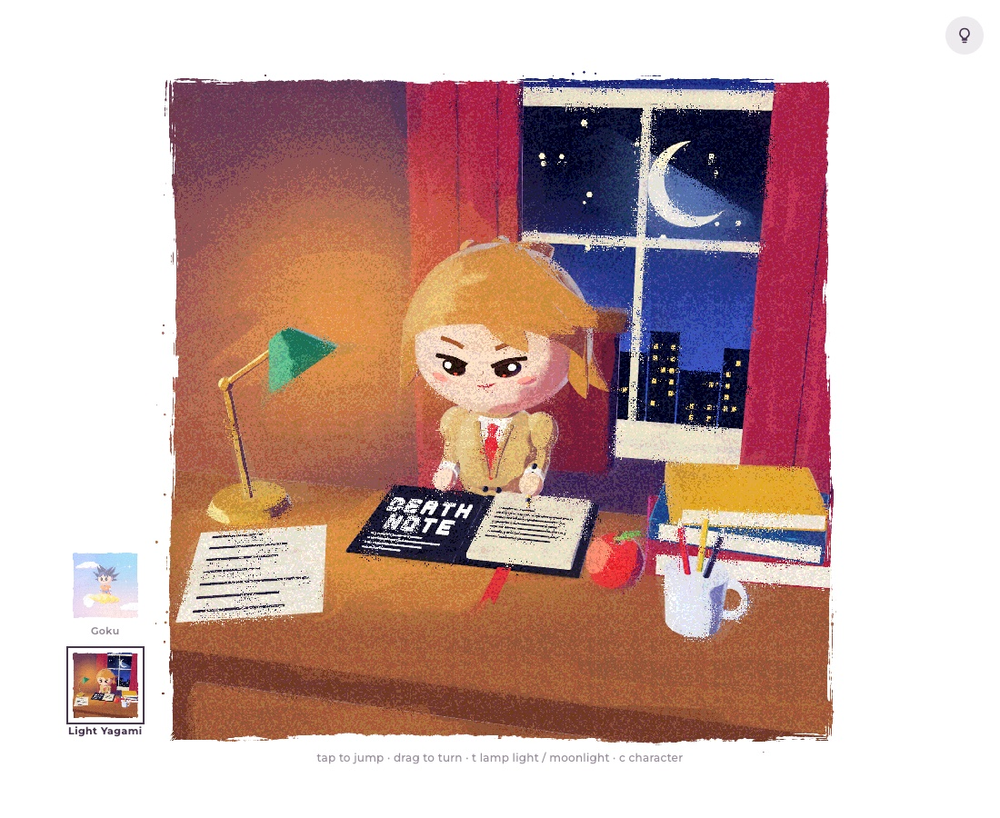
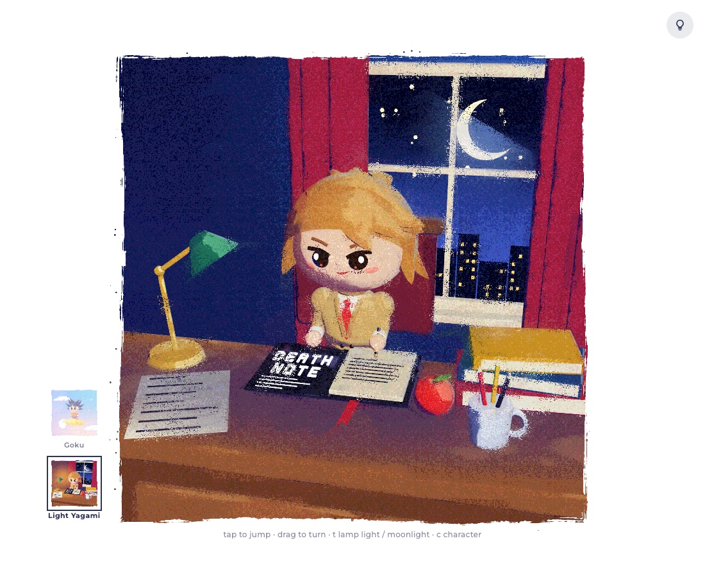

# Chibi Jelly Painting

A chibi martial-arts kid riding a wobbly cloud, and a smirking chibi Light Yagami
sitting at his desk at night, writing in the Death Note, painted live in the browser. One
page, one switch for the mood (day and dusk in the sky, lamp light and moonlight at
the desk), one toggle for who is in the painting.

<p>
  
  
  
</p>
<p>
  
  
</p>

- **Live:** [chibi-jelly-painting.vercel.app](https://chibi-jelly-painting.vercel.app)
- **Model:** Opus 5.5 (high) for the build, Sonnet 5.5 (high) for the final polish, video, repo and deploy
- **Tokens:** ~580K (300K input + 279K output), plus 35.7M read from cache
- **Time:** 1h 25m of active agent time, spread over several days of iteration
- **Built with:** Droid in the Factory app
- **Stack:** three.js WebGPU + TSL (WebGL 2 fallback), Vite
- **Style:** a screen-space paint filter after mesq's [Jelly Painting](https://x.com/mesqme/status/2106646827193778352)
- **Character:** built from primitives in code, with no model files

## Run it

```bash
npm install
npm run dev      # http://localhost:5173  (add ?webgl to force the WebGL 2 backend)
npm run build    # static build in dist/
```

## Controls

Tap the character to jump (Light only hops in his chair), tap the cloud (or Light's notebook) to bounce it, drag to orbit, scroll to zoom.
Two painted cards beside the sheet pick the character, **Goku** or **Light Yagami**
(he hops in on arrival); the selected one is outlined. An icon-only button in
the top right flips the mood: sun / moon for Goku's sky (day, dusk), lamp / moon
for Light's desk (lamp light, moonlight). The card previews are
captured from the live pipeline at load. Add `?char=light` to open on Light Yagami.
Keys: `space`/`j` jump · `w` wave · `t` mood · `c` next character · `1` Goku · `2` Light Yagami · `g` paint settings.

## How it works

- `src/materials/painted.js` — painted lighting. Object-space brush noise bends the
  shading normal (a procedural stand-in for hand-painted normal maps), then hard,
  noise-wobbled light bands break surfaces into flat painted planes with cool
  shadows, a rim light, a warm bounce from the cloud and a pastel haze that
  keeps the darks soft.
- `src/post/paintFilter.js` — the screen-space painting, all TSL:
  1. paper + torn frame (static): a square sheet with a torn, deckled edge,
     dry-brush bristles and loose paint flecks on the paper around it
  2. stroke grid (static): jittered dabs, each with a random ticket
  3. structure tensor of the colors (Sobel), blurred twice (detail + wide halo)
  4. flow: a stroke direction running along color edges, double-angle encoded
  5. strokes: march 10 steps each way along the flow, smear the color and let the
     strongest dab on the path claim the pixel with its flat center color
  6. composite: agreement-gated smear, speckle (cells that borrow color from a
     few pixels across the stroke, heaviest on edges) and a screen-locked
     9-level dither that gives the multi-hue pastel grain. Impasto relief,
     paper grain and edge pooling are available in the settings but off by default
- `src/scene/character.js` — the kid, built from primitives (no model files). It also
  exports the head, hair-blade and torso helpers the other character reuses.
- `src/scene/yagami.js` — Light Yagami, same recipe: honey-brown bowl cut with a swept
  fringe, narrow eyes with a red glint, a smirk, the tan jacket and red tie, and a pen
  in his right hand. He sits behind his desk instead of riding a cloud: the open Death
  Note on the desk plays the cloud's part (block lettering on the inside cover, names
  on the page, a bookmark ribbon that sways, a bounce when tapped), plus Ryuk's apple.
  Reference: the Death Note wiki and the Light Nendoroid.
- `src/scene/room.js` — his desk at night: the wooden desk (its top is as high as his
  waist, so it hides his legs) and the back of his chair, a brass desk lamp whose glow
  is a real uniform (`light.lamp`) that fades the halo, the pool of light on the desk
  and the bulb, a window onto a lit city with a crescent moon and Kira-red curtains,
  stacked books, a sheet of names and a mug of pencils. The wall is the painted
  backdrop; the far clouds and sparkles are hidden here.
- `src/scene/world.js` — the nimbus cloud (recolorable), far clouds, the painted
  multi-hue sky and the twinkling sparkles.
- `src/scene/rig.js` — springs for bobbing, blinking, head tracking, squash-and-stretch
  jumps, hair lag, tail swish and the occasional wave. A character can hold an arm
  pose by exposing `armRest` (with `scribble` for a hand that is writing), pick which
  arm waves (`waveSide`), bob and hop less (`bobScale`, `jumpScale`) and may have no
  tail. A prop can be `grounded`: it stays on its desk (`baseY`) and only squashes.
- `src/main.js` — also gives each character their own camera height (`view.polar`),
  so Light is seen from above enough to read the notebook; the camera eases there on
  a swap until you grab it.
- `src/themes.js` — two moods per world, eased every frame: `sky` (day, dusk) and `room`
  (lamp light, moonlight). The switch picks a slot; each character's world decides
  what it looks like.

Dev-only debug hook: `window.__chibi` (renderer, scene, camera, controls, filter, cast, theme, character).
