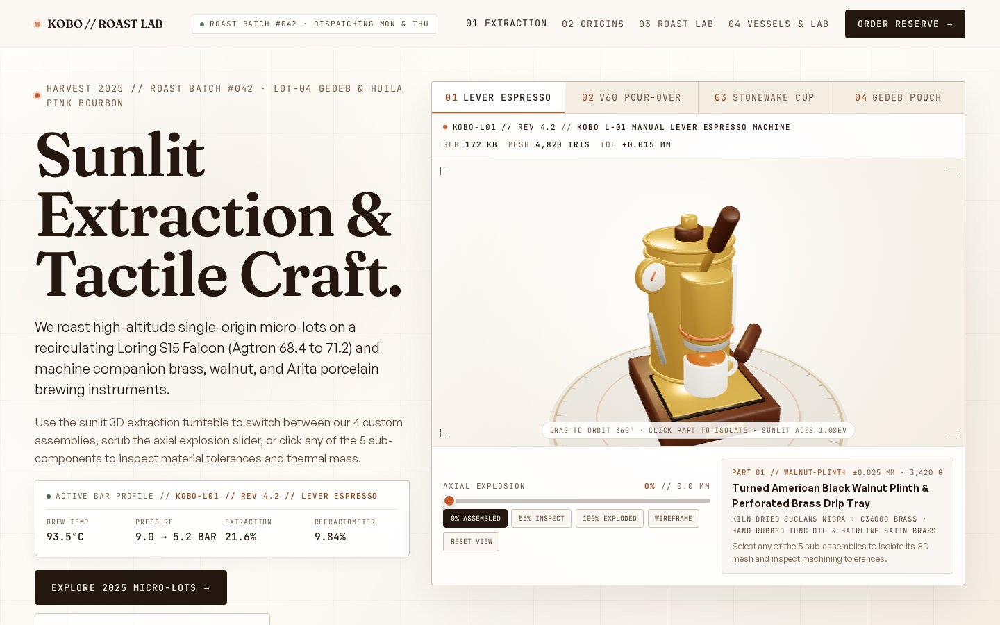
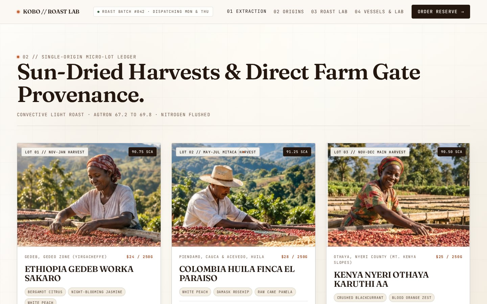
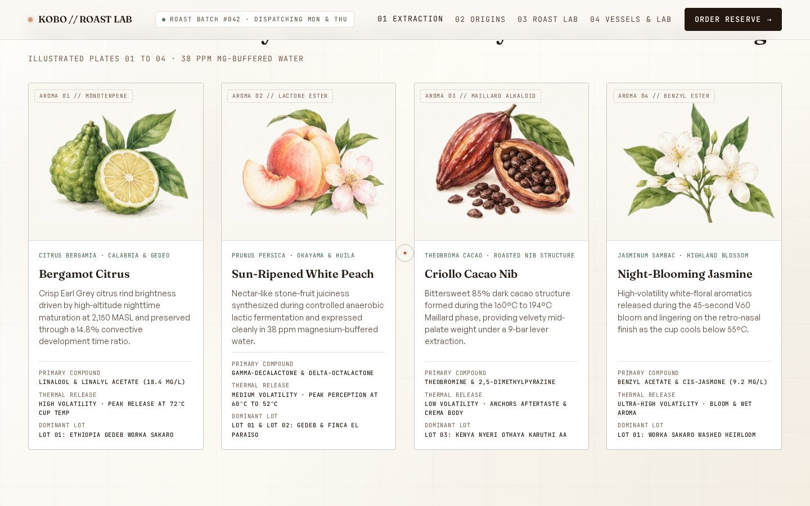
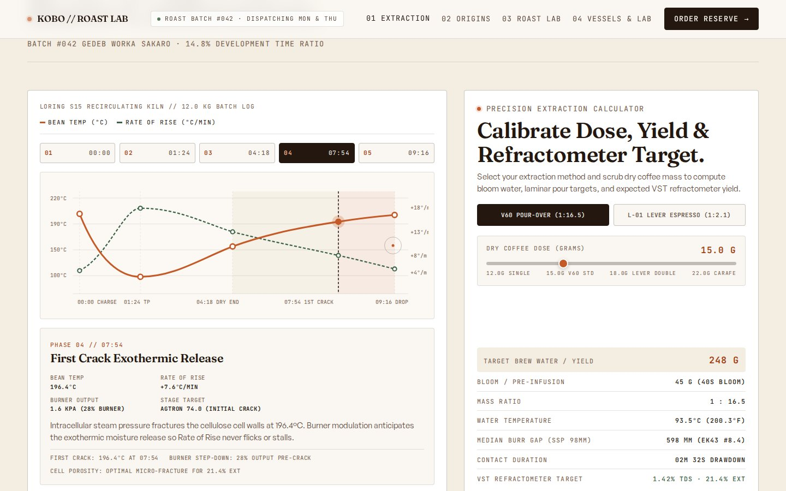
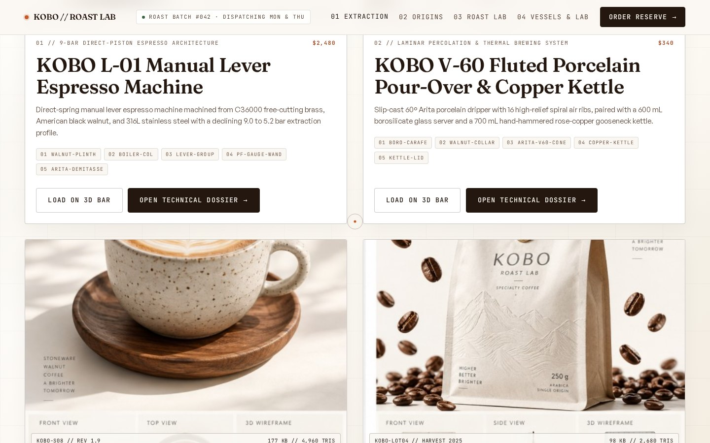
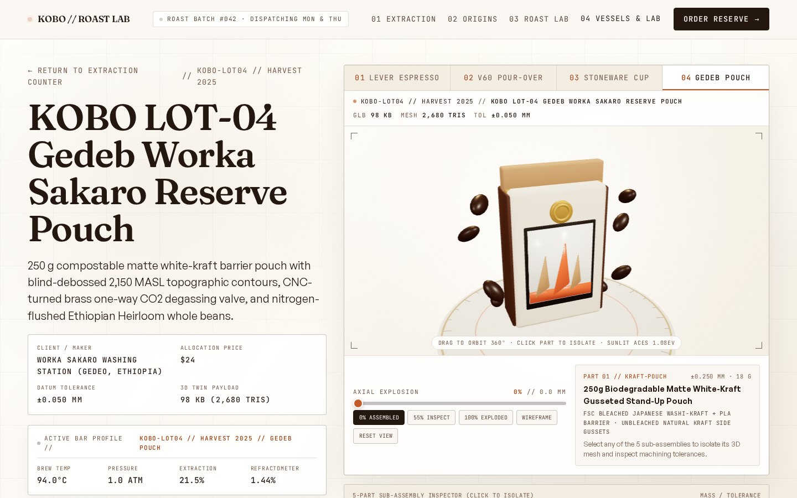

# KOBO // Roast Lab

A sun-drenched Japanese-Pacific Northwest specialty coffee roastery, convective roast
telemetry lab, and custom ceramic/brass brewing vessel studio (`KOBO // ROAST LAB ·
KYOTO & PORTLAND`) led by founder and extraction researcher Haruki Sato. Four original
multi-part 3D coffee specimens (**KOBO L-01 Manual Lever Espresso Machine**, **KOBO V-60
Fluted Porcelain Pour-Over & Copper Kettle**, **KOBO S-08 Mashiko Speckled Stoneware Cup
& Rosetta**, and **KOBO Lot-04 Gedeb Worka Sakaro Reserve Pouch**) are modeled
procedurally from scratch in headless Blender 4.2 (`bpy`) as sub-200 KB `.glb`
assemblies and mounted on a sunlit Three.js + GSAP extraction counter where visitors
explode each 5-part assembly along its vertical axis, isolate individual machined or
hand-thrown components, toggle wireframe topology, scrub a 5-phase Loring S15 Falcon
roast curve, or compute real-time dose-to-yield refractometer targets.

<p>
  
  
</p>
<p>
  
  
</p>
<p>
  
  
</p>

- **Live:** [kobo-roast-lab.vercel.app](https://kobo-roast-lab.vercel.app)
- **Built with:** Droid in the Factory app using [`juliobsz/skills`](https://github.com/juliobsz/skills) (`/awwwards` + `/jury`), AI asset direction (`GenerateImage`), and headless Blender 4.2.3 LTS
- **Stack:** Astro, Three.js (`GLTFLoader`), GSAP (`ScrollTrigger`), Lenis, TypeScript
- **3D & Visual Assets:** 4 multi-part PBR `.glb` coffee assemblies generated from scratch in Blender (`scripts/generate_models.py`, 102 KB to 197 KB) plus 10 sunlit botanical watercolor, single-origin farm, and turnaround specification plates (`public/images/`)
- **Blind `/jury` Score:** 8.01 / 10 on blind Pass 2 -> 8.61 / 10 final post-fix verification (`0 FAIL, 0 WARN` static audit, `728 KB` total page weight, `6 KB gz` initial JS, `0` axe violations, `0.000` mobile CLS)

## Run it

```bash
npm install
npm run dev      # http://localhost:4321
npm run build    # static build in dist/
```

To regenerate the 4 custom `.glb` coffee specimens from scratch with headless Blender 4.2+:

```bash
blender --background --python scripts/generate_models.py
```

## Controls

Drag inside the 3D extraction viewport to orbit the active specimen 360 degrees, scrub
the terracotta `AXIAL EXPLOSION` slider (or click `0% ASSEMBLED`, `50% CALIBRATED`,
`100% EXPLODED`) to separate the 5 sub-assemblies (`part_01_base` through
`part_05_vessel`) along their vertical axis, click any row in the `5-PART SUB-ASSEMBLY
INSPECTOR` or `SUB-ASSEMBLY BILL OF MATERIALS` table to isolate that component in 3D
space, switch between `01 LEVER ESPRESSO`, `02 V60 POUR-OVER`, `03 STONEWARE CUP`, and
`04 GEDEB POUCH`, or toggle `WIREFRAME` to inspect the underlying mesh topology. Down
the page, click `Load Recipe into 3D Stage` on any single-origin harvest card to
synchronize the hero 3D model and live brew telemetry (`BREW TEMP`, `PRESSURE`,
`EXTRACTION`, `REFRACTOMETER TDS`), click phases `01` through `05` on the Loring S15
roast curve to inspect bean temperature and Rate of Rise (`°C/min`), or drag the `DRY
COFFEE DOSE (GRAMS)` slider to compute target brew water, bloom weight, EK43 burr gap,
and expected VST refractometer yield.

## How it works

- `scripts/generate_models.py` — procedural headless Blender 4.2 Python (`bpy`) generator
  that builds all four specialty coffee assemblies from scratch with angle-limited bevel
  modifiers and sRGB-to-linear calibrated PBR materials (`Brushed_Brass`, `Rose_Copper`,
  `Polished_Steel`, `Turned_Walnut`, `Porcelain_Cream`, `Speckled_Stoneware`,
  `White_Kraft`, `Natural_Kraft`, `Espresso_Crema`, `Espresso_Roast`, `Amber_Coffee`,
  `Borosilicate_Glass`, `Terracotta_Glaze`, `Matte_Obsidian`), exporting 5 named
  sub-assembly nodes (`part_01_base` through `part_05_vessel`) into `public/models/*.glb`:
  1. `kobo-lever-espresso.glb` (197 KB) — turned American black walnut plinth with brass
     feet and drip tray, brushed C36000 brass boiler column with sight-glass tube,
     direct-piston spring lever fork and walnut grip, 58mm bottomless portafilter with
     Bourdon pressure gauge and steam wand, and Arita porcelain demitasse cup with
     golden crema.
  2. `kobo-pourover-set.glb` (142 KB) — conical borosilicate glass carafe with glowing
     amber brewed coffee, turned walnut thermal collar, 16-rib spiral-fluted Arita
     porcelain V60 dripper with coffee bloom bed, Tsubame rose-copper gooseneck kettle,
     and fitted copper lid with walnut finial knob.
  3. `kobo-stoneware-cup.glb` (193 KB) — lathe-turned oiled walnut saucer, wood-fired
     Mashiko iron-speckled stoneware bowl with unglazed terracotta foot ring, hand-pulled
     stoneware ear handle, double-ristretto crema base, and 3D sculpted microfoam Rosetta
     latte art.
  4. `kobo-coffee-pouch.glb` (102 KB) — matte white-kraft stand-up pouch with walnut
     side gussets, framed dark-espresso and terracotta topographic ridge relief label,
     ultrasonic crimp header with brass zipper, CNC-turned brass one-way CO2 degassing
     valve, and floating roasted Arabica beans.
- `src/scripts/workbench-stage.ts` & `src/components/BenchStage.astro` — the sunlit
  Three.js `GLTFLoader` turntable stage (`ACESFilmicToneMapping` at `1.12 EV`, 5-light
  daylight studio rig, travertine vernier calibration ring, axial explosion kinematics,
  part isolation, and `IntersectionObserver` off-screen pause) plus interactive roast
  curve and brew ratio calculator controllers.
- `src/engine/` (`index.ts`, `scroll.ts`, `reveal.ts`, `transition.ts`, `loader.ts`,
  `interactions.ts`) — single-clock motion engine driving Lenis smooth scroll, masked
  line reveals, porcelain-and-terracotta curtain page transitions, fast inline
  calibration preloader, and translucent terracotta reticle cursor follower.
- `src/data/projects.ts` — typed single source of truth for the 4 3D specimens, 5-part
  BOM tables, 3 single-origin harvest lots, 4 botanical aroma compounds, 5 Loring S15
  roast curve phases, and Kyoto/Portland tasting bar allocations.
- `DESIGN.md` & `JURY_SCORECARD.md` — full `/awwwards` design specification and
  multi-pass blind `/jury` + specialty coffee copywriting audit scorecard.
