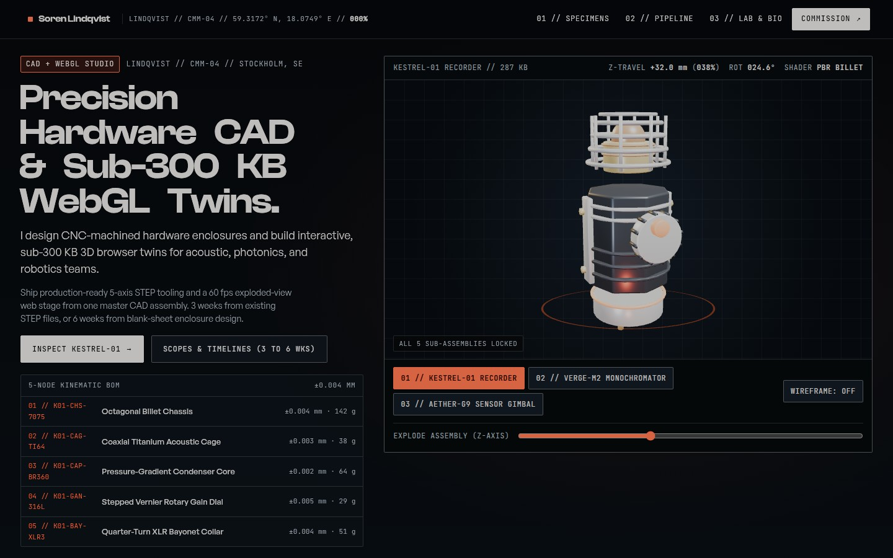
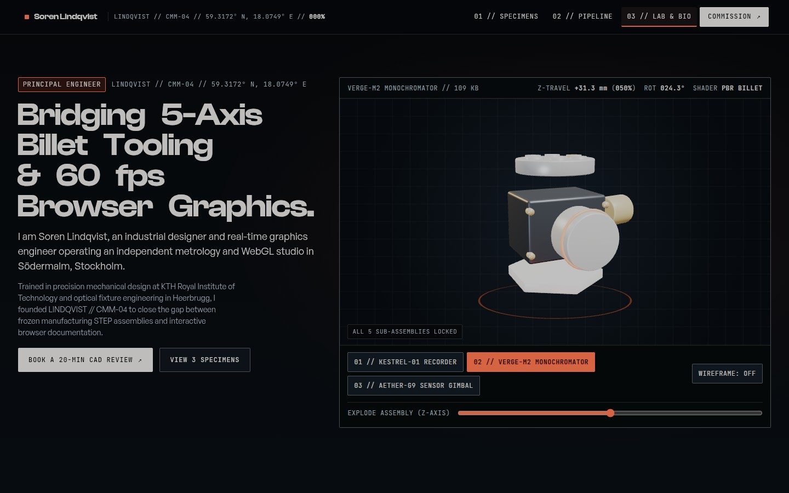
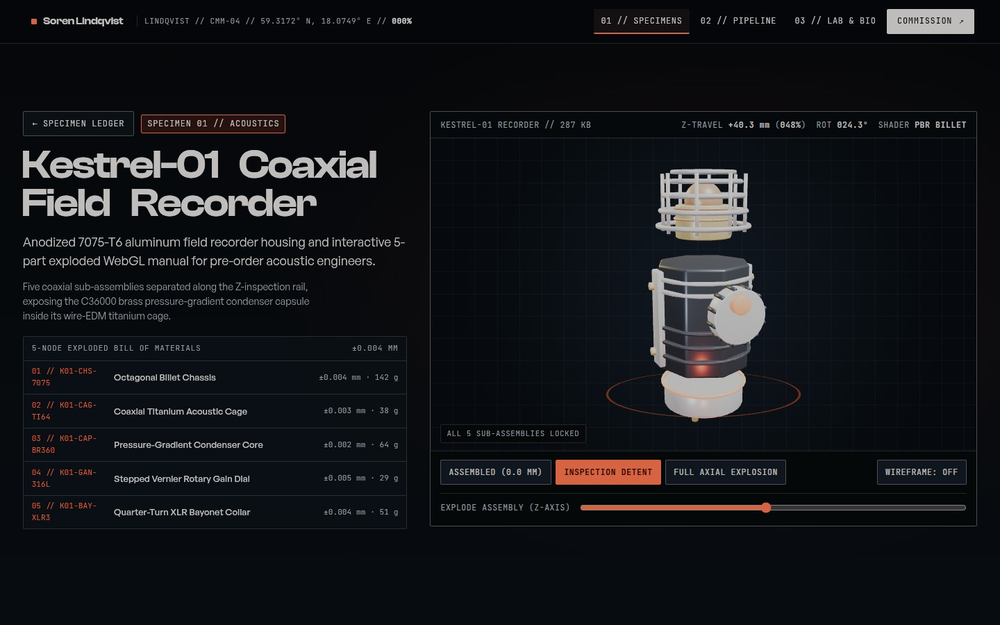
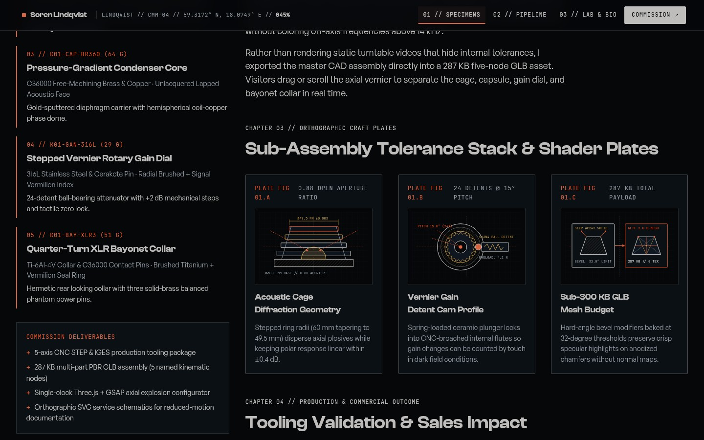
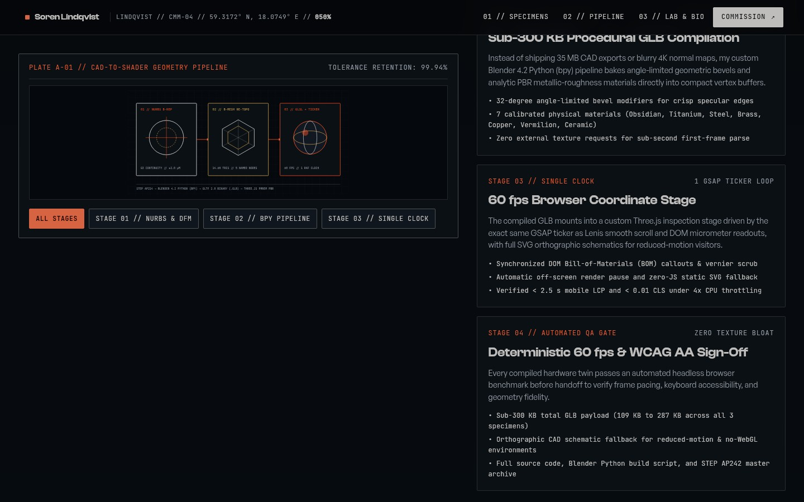
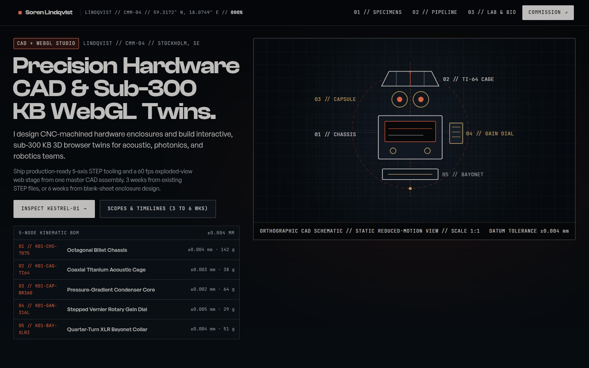

# Lindqvist CMM-04

An interactive Coordinate Measuring Machine (`LINDQVIST // CMM-04`) inspection bench and
industrial hardware + WebGL studio portfolio for Stockholm product designer and graphics
engineer Soren Lindqvist. Three custom multi-part CNC hardware specimens (**Kestrel-01
Coaxial Field Recorder**, **Verge-M2 Optical Monochromator** and **Aether-G9 3-Axis Sensor
Gimbal**) are modeled procedurally from scratch in headless Blender 4.2 (`bpy`) as
sub-300 KB `.glb` assemblies and mounted in a single-clock 60 fps Three.js + GSAP stage
where visitors explode each 5-node mechanical assembly along its Z-axis, lock individual
Bill-of-Materials (BOM) sub-assemblies, toggle wireframe topology, or inspect 1:1
orthographic CAD schematics.

<p>
  
  
</p>
<p>
  
  
</p>
<p>
  
  
</p>

- **Live:** [lindqvist-cmm-04.vercel.app](https://lindqvist-cmm-04.vercel.app)
- **Built with:** Droid in the Factory app using [`juliobsz/skills`](https://github.com/juliobsz/skills) (`/awwwards` + `/jury`) and headless Blender 4.2.3 LTS
- **Stack:** Astro, Three.js (`GLTFLoader`), GSAP (`ScrollTrigger`, `SplitText`), Lenis, TypeScript
- **3D Assets:** 3 multi-part PBR `.glb` hardware assemblies generated from scratch in Blender (`scripts/generate_models.py`, 109 KB to 287 KB, zero external textures)
- **Blind `/jury` Score:** 8.00 / 10 weighted overall (8/10 Design, 8/10 Usability, 8/10 Creativity, 8/10 Content, 9/10 WPO, `0 FAIL, 0 WARN` audit)
- **Model, Tokens & Time:** Gemini 4 Argon (high) across 1 orchestrator + 5 subagents · `~8.24M` uncached tokens (`~37.86M` total including `29.62M` prompt cache reads, `572K` output tokens) · `4h 53m` active compute time

## Run it

```bash
npm install
npm run dev      # http://localhost:4321
npm run build    # static build in dist/
```

To regenerate the `.glb` hardware assemblies from scratch with headless Blender 4.2+:

```bash
blender --background --python scripts/generate_models.py
```

## Controls

Drag inside the 3D coordinate viewport to orbit the mounted specimen, drag the orange
`EXPLODE ASSEMBLY (Z-AXIS)` vernier slider (or scroll through the hero) to separate the
5 mechanical sub-assemblies along their kinematic axis, click any row in the `5-NODE
KINEMATIC BOM` table to isolate and highlight that sub-assembly on the 3D mesh, click
`01 // KESTREL-01 RECORDER`, `02 // VERGE-M2 MONOCHROMATOR` or `03 // AETHER-G9 SENSOR
GIMBAL` to index the turret to another specimen, or toggle `WIREFRAME: ON/OFF` to inspect
the decimated B-Mesh polygon topology. On case study pages (`/work/kestrel-01`,
`/work/verge-m2`, `/work/aether-g9`), use the three calibration detent buttons
(`ASSEMBLED (0.0 MM)`, `INSPECTION DETENT`, `FULL AXIAL EXPLOSION`) to snap the assembly
to preset inspection positions. Under `prefers-reduced-motion: reduce`, the live WebGL
canvas automatically yields to a static 1:1 orthographic CAD blueprint.

## How it works

- `scripts/generate_models.py` — procedural headless Blender 4.2 Python (`bpy`) generator
  that builds all three hardware specimens from scratch with 32-degree angle-limited
  bevel modifiers and 7 calibrated PBR metallic-roughness materials (`Anodized_Obsidian`,
  `Brushed_Titanium`, `Machined_Steel`, `Raw_Brass`, `Coil_Copper`, `Signal_Vermilion`,
  `Technical_Ceramic`), exporting 5 named sub-assembly nodes (`part_01_chassis` through
  `part_05_bayonet_mount`) into `public/models/*.glb`:
  1. `kestrel-recorder.glb` (287 KB) — octagonal CNC billet body with heat-dissipation
     ribs, titanium side rails, hex socket cap screws, 4-ring stepped titanium acoustic
     cage, brass condenser core with copper phase rings, knurled rotary gain dial, and
     quarter-turn XLR bayonet collar.
  2. `verge-monochromator.glb` (109 KB) — anodized optical block with brass mounting
     bosses, 6-position diffraction grating wheel, collimator barrel with vermilion
     seal ring, micrometer drum, and ceramic kinematic baseplate.
  3. `aether-gimbal.glb` (153 KB) — outer gimbal yoke with bearing trunnions, canted
     titanium pitch ring, icosahedral brass inertial core with equatorial optical band,
     vermilion roll calibration ring, and machined steel stator pedestal.
- `src/motion/bench.ts` & `src/motion/idle.ts` — the Three.js `GLTFLoader` inspection
  stage, studio lighting rig (key, cool rim, warm brass under-bounce), axial explosion
  kinematics, BOM node isolation, wireframe switcher, pointer orbit, and multi-frequency
  harmonic idle drift.
- `src/engine/scroll.ts`, `src/engine/reveal.ts`, `src/engine/transition.ts`,
  `src/engine/loader.ts` & `src/engine/interactions.ts` — single-clock motion engine
  driving Lenis smooth scroll, GSAP `ScrollTrigger` reveals, `SplitText` typography,
  optical datum shutter page transitions, calibration loader, and reticle cursor follower
  from one `gsap.ticker` loop (`lagSmoothing(0)`).
- `src/components/BenchStage.astro` & `src/components/PipelineSchematic.astro` — the
  3D turret viewport with synchronized DOM telemetry readouts, reduced-motion SVG CAD
  blueprints, and the sticky `PLATE A-01` CAD-to-shader pipeline schematic.
- `src/data/site.ts` — typed single source of truth for studio positioning, bench
  telemetry, 5-node BOM tables, case study chapters, and fixed-fee commissioning scopes.
- `DESIGN.md` & `JURY_SCORECARD.md` — full `/awwwards` design specification and the
  3-pass blind `/jury` + B2B copywriting audit scorecard.
